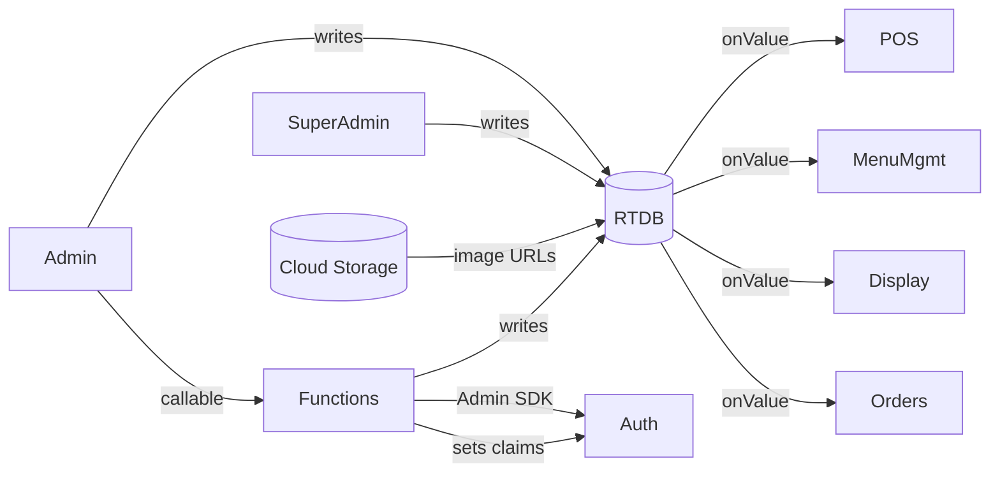

# Restaurant POS MVP — Complete Project Overview

End-to-end reference for what was implemented, how each part works, and the rationale behind every architectural decision. Read this together with `README.md` (which focuses on setup steps).

---

## Table of contents

1. [High-level architecture](#1-high-level-architecture)
2. [Tech stack and why](#2-tech-stack-and-why)
3. [Repository layout](#3-repository-layout)
4. [Environment configuration](#4-environment-configuration)
5. [Firebase Emulator support](#5-firebase-emulator-support)
6. [Firebase Realtime Database schema](#6-firebase-realtime-database-schema)
7. [Security rules](#7-security-rules)
8. [Cloud Functions](#8-cloud-functions)
9. [Authentication and role hydration](#9-authentication-and-role-hydration)
10. [State management (Zustand stores)](#10-state-management-zustand-stores)
11. [Routing and route guards](#11-routing-and-route-guards)
12. [Super Admin module](#12-super-admin-module)
13. [Admin module](#13-admin-module)
14. [Menu management module](#14-menu-management-module)
15. [POS / order taking](#15-pos--order-taking)
16. [Cash checkout and receipt](#16-cash-checkout-and-receipt)
17. [Order history](#17-order-history)
18. [Public product display page](#18-public-product-display-page)
19. [Realtime data flow](#19-realtime-data-flow)
20. [Styling and UX system](#20-styling-and-ux-system)
21. [Testing the system end-to-end](#21-testing-the-system-end-to-end)
22. [Production readiness notes](#22-production-readiness-notes)
23. [Future extension hooks](#23-future-extension-hooks)

---

## 1. High-level architecture

```
┌──────────────────────────────────────────────────────────────────────────────┐
│                                Browser (Vite)                                │
│  ┌──────────────┐  ┌──────────────┐  ┌─────────────────┐  ┌───────────────┐  │
│  │ Super Admin  │  │ Admin POS    │  │ Menu Mgmt UI    │  │ Display Page  │  │
│  └──────┬───────┘  └──────┬───────┘  └────────┬────────┘  └───────┬───────┘  │
│         │ Zustand stores (auth, cart, company-context)            │          │
│         └────────────┬────────────────────────────────┬───────────┘          │
│                      │ Firebase Web SDK v10 (modular)                        │
└──────────────────────┼──────────────────────────────────────────────┼────────┘
                       │                                              │
                ┌──────▼──────┐ ┌──────────────┐  ┌─────────────────┐│
                │ Auth        │ │ RTDB         │  │ Cloud Storage   ││
                └─────────────┘ └──────────────┘  └─────────────────┘│
                                                                     ▼
                                                       ┌──────────────────────┐
                                                       │ Cloud Functions      │
                                                       │ (createCompanyAdmin, │
                                                       │  deleteCompany, ...) │
                                                       └──────────────────────┘
```

- The browser app talks **directly** to RTDB, Auth, and Storage using the modular SDK and realtime listeners.
- The app calls Cloud Functions **only** for operations that need the Admin SDK (creating/deleting auth users, setting custom claims).
- All multi-tenant data is partitioned by `companyId` so the same database can host many restaurants.

---

## 2. Tech stack and why

| Concern         | Choice                                  | Reason                                                              |
| --------------- | --------------------------------------- | ------------------------------------------------------------------- |
| Build tool      | **Vite**                                | Fast HMR, modern ESM, tiny config                                   |
| UI lib          | **React 18** + TypeScript               | Mature ecosystem, type safety                                       |
| Styling         | **Tailwind CSS**                        | Utility-first, responsive without writing custom CSS                |
| State           | **Zustand** (3 small stores)            | Minimal boilerplate; persistence middleware for cart and context    |
| Forms           | **React Hook Form** + **Zod**           | Performance + schema-first validation                               |
| Notifications   | **react-hot-toast**                     | Lightweight, zero-config                                            |
| Routing         | **react-router-dom v6**                 | Declarative nested routes, layout routes                            |
| Backend         | **Firebase** (RTDB, Auth, Storage, Fn.) | Realtime out of the box, single managed platform                    |
| Functions lang. | **TypeScript** (Node 20)                | Shares types/contract style with the client                         |

---

## 3. Repository layout

```
/
├── src/
│   ├── lib/firebase.ts                    Firebase SDK init + emulator wiring
│   ├── stores/
│   │   ├── authStore.ts                   Sign in/out + role hydration
│   │   ├── companyContextStore.ts         Active company (Super Admin can switch)
│   │   ├── cartStore.ts                   POS cart, discount, table number
│   │   └── posKioskStore.ts               Browser kiosk (fullscreen) flag
│   ├── services/                          Thin RTDB / Storage / Functions wrappers
│   │   ├── companies.ts
│   │   ├── menu.ts
│   │   ├── orders.ts
│   │   ├── users.ts
│   │   └── functionsApi.ts
│   ├── hooks/                             Realtime subscription bundlers
│   │   ├── useCompany.ts
│   │   ├── useCompanyMenu.ts
│   │   ├── useOrders.ts
│   │   └── usePosKioskMode.ts             Fullscreen / keyboard / wake lock
│   ├── routes/ProtectedRoute.tsx          Role-aware route guard
│   ├── components/
│   │   ├── common/{LoadingScreen,ConfirmDialog,EmulatorBadge}.tsx
│   │   └── pos/{CartPanel,ItemModifierModal}.tsx
│   ├── pages/
│   │   ├── auth/LoginPage.tsx
│   │   ├── super-admin/{SuperAdminLayout,CompaniesPage,CompanyFormPage}.tsx
│   │   ├── admin/
│   │   │   ├── AdminLayout.tsx
│   │   │   ├── menu/{CategoriesPage,ItemsPage,ModifiersPage}.tsx
│   │   │   ├── pos/{PosPage,CheckoutModal,ReceiptPage}.tsx
│   │   │   └── orders/OrderHistoryPage.tsx
│   │   └── display/DisplayPage.tsx
│   ├── types/index.ts                     Domain types (User/Company/Menu/Order/Cart)
│   ├── utils/{currency,orderCalc,idGen,cn}.ts
│   ├── App.tsx                            Router root + emulator badge
│   ├── main.tsx                           Mount + Toaster
│   └── index.css                          Tailwind layers + custom utility classes
├── functions/
│   ├── src/index.ts                       createCompanyAdmin, updateCompanyAdmin,
│   │                                       deleteCompany, setSuperAdminClaim
│   ├── package.json, tsconfig.json
├── database.rules.json                    RTDB security rules
├── storage.rules                          Storage security rules
├── firebase.json                          Project config (rules, functions, hosting, emulators)
├── .firebaserc                            Firebase project alias
├── .env.example                           Env template (prod + emulator vars)
├── tailwind.config.js, postcss.config.js  Styling pipeline
├── vite.config.ts, tsconfig*.json         Build config
├── README.md                              Setup + how-to
└── PROJECT_OVERVIEW.md                    THIS file
```

---

## 4. Environment configuration

All env vars are read via `import.meta.env` and typed in [`src/vite-env.d.ts`](src/vite-env.d.ts).

```env
# Prod / live Firebase
VITE_FIREBASE_API_KEY=...
VITE_FIREBASE_AUTH_DOMAIN=...
VITE_FIREBASE_DATABASE_URL=...
VITE_FIREBASE_PROJECT_ID=...
VITE_FIREBASE_STORAGE_BUCKET=...
VITE_FIREBASE_MESSAGING_SENDER_ID=...
VITE_FIREBASE_APP_ID=...
VITE_FIREBASE_FUNCTIONS_REGION=us-central1

# Emulator
VITE_USE_EMULATOR=false
VITE_EMULATOR_HOST=127.0.0.1
VITE_EMULATOR_AUTH_PORT=9099
VITE_EMULATOR_DATABASE_PORT=9000
VITE_EMULATOR_STORAGE_PORT=9199
VITE_EMULATOR_FUNCTIONS_PORT=5001
```

---

## 5. Firebase Emulator support

Implemented in [`src/lib/firebase.ts`](src/lib/firebase.ts).

1. The app **always** initialises a single Firebase app with `initializeApp(config)`.
2. When `VITE_USE_EMULATOR` is truthy (`true`, `1`, `yes`, `on`), each service is re-pointed at the local emulator:
   - `connectAuthEmulator(auth, "http://HOST:9099")`
   - `connectDatabaseEmulator(db, HOST, 9000)`
   - `connectStorageEmulator(storage, HOST, 9199)`
   - `connectFunctionsEmulator(functions, HOST, 5001)`
3. While in emulator mode the RTDB `databaseURL` is rewritten to
   `http://HOST:9000?ns=<projectId>-default-rtdb`, which is the format the Database Emulator expects.
4. A floating **EMULATOR** pill (`src/components/common/EmulatorBadge.tsx`) renders on every screen so you cannot accidentally mistake the environment.
5. The exported `firebaseEnv` object (`{ useEmulator, projectId, region }`) is the single source of truth other components consume.

How to run the full local stack:

```bash
# 1. flip the flag
echo VITE_USE_EMULATOR=true >> .env

# 2. start emulators (Java required for db/storage)
npm run emulators            # all emulators per firebase.json
# or
npm run emulators:functions  # auth + db + storage + functions only

# 3. start the Vite dev server in another terminal
npm run dev
```

When the badge appears bottom-left, every Firebase call is local. Toggling the flag back to `false` and refreshing returns the app to production Firebase — no code change needed.

---

## 6. Firebase Realtime Database schema

```
/users/{uid}
  email, name, role: "super_admin" | "admin", companyId?, password?, createdAt

/companies/{companyId}
  name, location, logoUrl?, phone?, adminUid, adminEmail, adminName,
  active, createdAt, createdBy

/menu/{companyId}
  categories/{categoryId}
    name, imageUrl?, sortOrder, active, createdAt, companyId
  items/{itemId}
    categoryId, name, description?, basePrice, imageUrl?, available,
    modifierGroupIds[], sortOrder, createdAt, companyId
  modifierGroups/{groupId}
    name, required, min, max,
    options: { optionId: { id, name, priceAdjustment } },
    createdAt, companyId

/orders/{companyId}/{orderId}
  orderNumber, orderDate?, items[snapshot], tableNumber?, subtotal,
  discount { type, value, amount, appliedBy?, appliedByName?, at? },
  total, paymentMethod: "cash" | "card_reader" | "tap_to_pay",
  paymentStatus: "pending" | "paid" | "refunded",
  status: "pending" | "completed" | "cancelled",
  cashReceived?, change?, stripePaymentIntentId?,
  refundedAt?, refundedBy?, refundedByName?, stripeRefundId?,
  createdBy, createdByName, createdAt, completedAt?
  (.indexOn createdAt, status, stripePaymentIntentId, kioskIdempotencyKey)

/counters/{companyId}/dailyOrderSeq/{YYYY-MM-DD}
  integer — incremented atomically per order via runTransaction (resets each UTC day)
```

Important design points:

- Order items are **denormalised snapshots** — changing a menu item later never mutates historical orders or receipts.
- Each `companyId` cleanly partitions everything, allowing the same Firebase project to host many restaurants.
- `orderNumber` is human readable (1, 2, 3 ... per UTC day) and reused as the receipt number; displayed padded as `001`. `orderDate` stores the UTC `YYYY-MM-DD` the number was minted for. Durable identity remains the Firebase push key `id`.
- The discount audit trail (`appliedBy`, `appliedByName`, `at`) is stored on every discounted order, satisfying the spec's discount tracking requirement.

---

## 7. Security rules

### RTDB ([`database.rules.json`](database.rules.json))

- `/users` — readable only by self or a super admin; writes go through Cloud Functions or super admin.
- `/companies` — super admin reads everything; an admin can read only their own company; writes only by super admin.
- `/menu/{companyId}` — **read: true** (so the public Display Page works with no auth). Writes restricted to super admin or `auth.token.role == "admin" && auth.token.companyId == companyId`.
- `/orders/{companyId}` and `/counters/{companyId}` — read+write only for super admin or matching admin.

### Storage ([`storage.rules`](storage.rules))

- `companies/{companyId}/logo/**` — public read; writable by super admin.
- `menu/{companyId}/**` — public read; writable by super admin or matching admin.
- Hard image-only enforcement (`request.resource.contentType.matches('image/.*')`) and 5 MB cap.

Both rule files exploit **custom claims** (`auth.token.role`, `auth.token.companyId`) that Cloud Functions attach when an admin account is created (or on first super-admin login). That keeps the rules concise.

---

## 8. Cloud Functions

File: [`functions/src/index.ts`](functions/src/index.ts) (Firebase Functions v2, Node 20).

### `createCompanyAdmin` (callable)
1. Verifies the caller is `super_admin` in RTDB.
2. Creates the Firebase Auth user with the supplied email / password / display name.
3. Sets custom claims `{ role: "admin", companyId }`.
4. Atomically writes `/companies/{id}` and `/users/{uid}` (including plaintext `password`).
5. Returns `{ companyId, adminUid }`.

### `updateCompanyAdmin` (callable)
- Updates the admin's display name / password via the Admin SDK, mirrors the name back to `/companies/{id}.adminName` and `/users/{uid}.name`, and mirrors the password to `/users/{uid}.password` when changed.

### `deleteCompany` (callable)
- Verifies super admin.
- Deletes the admin Auth user.
- Removes `/companies/{id}`, `/menu/{id}`, `/orders/{id}`, `/counters/{id}`, `/users/{adminUid}` in one update.

### `setSuperAdminClaim` (callable)
- Idempotent helper called by the client on the manually bootstrapped super admin's first sign-in. Verifies the RTDB role flag, then attaches the `role: "super_admin"` custom claim. Once set, the security rules trust the token forever.

### `refundOrder` (callable, in `payments.ts`)
- Verifies company admin (matching `companyId` claim) or super admin.
- Full-order only: requires `status: completed` and `paymentStatus: paid`.
- Cash: patches order to `cancelled` / `refunded` with audit fields.
- Card: creates a Stripe refund on `stripePaymentIntentId`, then same RTDB patch (stores `stripeRefundId`).
- Idempotent if the order is already refunded.

All callables sit behind the standard Firebase callable contract (auth context auto-attached) and return typed payloads consumed by [`src/services/functionsApi.ts`](src/services/functionsApi.ts).

---

## 9. Authentication and role hydration

Implementation: [`src/stores/authStore.ts`](src/stores/authStore.ts).

Lifecycle on app boot (`App.tsx -> useEffect(() => init())`):

1. `onAuthStateChanged` fires.
2. If no user → `{ user: null, initialized: true }` and the router sends them to `/login`.
3. If a user is present → fetch `/users/{uid}` from RTDB:
   - If missing → sign out and surface an error ("no role assigned").
   - Otherwise extract claims from the token:
     - If the role is `super_admin` but the claim isn't there → call `setSuperAdminClaim`, then refresh the token (`getIdToken(true)`).
     - If the role is `admin` but claims are stale → force-refresh the token.
4. Hydrate the store with `{ uid, role, companyId, email, name }`.

This means the client's idea of "who you are" is always **derived from RTDB**, and Firebase tokens are kept in sync so the security rules can trust them.

---

## 10. State management (Zustand stores)

### `authStore`
- `user`, `initialized`, `loading`, `error`
- `signIn`, `signOut`, `init`

### `companyContextStore` (persisted to localStorage)
- `activeCompanyId`: the company currently being managed.
- `isImpersonating`: true when a super admin has "View"-ed someone else's company.
- `setActiveCompany(id, isImpersonating)`, `clear()`.
- Admins always have `activeCompanyId === user.companyId` (synced in `App.tsx`).

### `cartStore` (persisted to localStorage, scoped per company)
- `companyId`, `lines`, `tableNumber`, `discountType`, `discountValue`, `editingOrderId`, `editingOrderNumber`.
- `addLine`, `updateLineQuantity`, `removeLine`, `setTableNumber`, `setDiscount`, `clear`, `loadFromOrder`, `cancelEdit`.
- Selectors: `subtotal()`, `discountAmount()`, `total()` — backed by pure functions in `utils/orderCalc.ts`.
- Switching companies wipes the cart automatically so super admin impersonation never mixes carts.

---

## 11. Routing and route guards

[`src/App.tsx`](src/App.tsx) declares:

```
/login                                            public
/display/:companyId                               public
/super-admin/*                                    Protected, role=super_admin
   /companies, /companies/new, /companies/:id/edit
/admin/*                                          Protected, role=super_admin | admin
   /pos
   /receipt/:orderId
   /menu/categories, /menu/items, /menu/modifiers
   /orders
/                                                 redirects by role
*                                                 redirects to /login
```

`ProtectedRoute` blocks access based on `allow={UserRole[]}` and shows the loading screen until auth initialises. Unauthorised users are redirected to their natural home (super admin → `/super-admin`, admin → `/admin/pos`).

---

## 12. Super Admin module

### Companies list ([`CompaniesPage.tsx`](src/pages/super-admin/CompaniesPage.tsx))
- Realtime subscription to `/companies`.
- Card grid with logo, name, location, admin email, active badge.
- Search by name / location / admin email.
- Per card actions:
  - **View** — sets `companyContextStore.activeCompanyId = company.id`, `isImpersonating = true`, then redirects to `/admin/pos`.
  - **Edit** — opens the form in edit mode.
  - **Delete** — confirmation dialog → calls `deleteCompany` Cloud Function.

### Company form ([`CompanyFormPage.tsx`](src/pages/super-admin/CompanyFormPage.tsx))
- Single Zod schema with conditional `password` validation (required for create, optional for edit).
- Fields: logo upload (Firebase Storage), company name, location, phone, admin name, admin email, password, confirm password, active toggle (edit only).
- **Create**: calls `createCompanyAdmin`, then if a logo file is attached uploads to `companies/{id}/logo/...` and patches `/companies/{id}.logoUrl`.
- **Edit**: updates `/companies/{id}` directly; calls `updateCompanyAdmin` if the admin name or password changed.

### Impersonation banner
Rendered in `AdminLayout` (yellow strip at the top) whenever `companyContextStore.isImpersonating === true`. Exit button calls `clear()` and routes back to `/super-admin/companies`.

---

## 13. Admin module

### Layout ([`AdminLayout.tsx`](src/pages/admin/AdminLayout.tsx))
- Sidebar with: POS, Categories, Items, Modifiers, Orders, **Display Page** (opens `/display/:companyId` in a new tab).
- Header on mobile (hamburger toggles the sidebar).
- Shows the active company's name + logo.
- Shows the impersonation banner when applicable.
- "Sign out" clears the company context too.

If a super admin lands on `/admin/*` without an active company they get a friendly empty state pointing back to the company list.

---

## 14. Menu management module

All three pages share `useCompanyMenu(companyId)` which subscribes to `categories`, `items`, and `modifierGroups` under `/menu/{companyId}` and exposes a single `loading` flag.

### Categories ([`CategoriesPage.tsx`](src/pages/admin/menu/CategoriesPage.tsx))
- Grid of category cards.
- Drawer-style modal to create / edit a category (name, optional image, sort order, active flag).
- Image upload routed through `uploadMenuImage(companyId, file, 'categories')`.

### Items ([`ItemsPage.tsx`](src/pages/admin/menu/ItemsPage.tsx))
- Category filter pills with counts.
- Cards show image, name, price, category, an **availability checkbox** (toggles instantly via `toggleItemAvailability`).
- Drawer for create / edit: category select, name, description, base price, image, sort order, available flag, multi-select **Modifier Groups** linkage.
- Image upload routed through `uploadMenuImage(companyId, file, 'items')`.

### Modifier Groups ([`ModifiersPage.tsx`](src/pages/admin/menu/ModifiersPage.tsx))
- List of groups with badges showing `Required` / `Optional` and `Min / Max`.
- Each group lists its options inline with edit / remove buttons.
- Options have `name` and `priceAdjustment` (can be negative).
- Group fields: name, required flag, min, max selections.

All writes go through small functions in [`src/services/menu.ts`](src/services/menu.ts). Every change is RTDB-pushed and propagates instantly to all open POS and Display sessions.

---

## 15. POS / order taking

[`PosPage.tsx`](src/pages/admin/pos/PosPage.tsx) layout: left side product grid, right side cart panel (collapsible "Cart" FAB on mobile).

Flow:

1. Subscriptions: `useCompanyMenu` fills categories, items, modifier groups in realtime.
2. Item tap:
   - If the item has **no modifier groups** → it's added straight to the cart with quantity 1.
   - Otherwise → opens [`ItemModifierModal`](src/components/pos/ItemModifierModal.tsx) which enforces `min/max` per group (max=1 behaves as radio, `max>1` as checkboxes), allows quantity, and accepts an optional note.
3. The cart store stores each addition as a `CartLine` with snapshotted `unitPrice` (base + modifier adjustments) and `lineTotal`.

[`CartPanel.tsx`](src/components/pos/CartPanel.tsx) shows:

- Editable table number.
- Each line with modifiers, note, quantity stepper, line total, and remove button.
- Discount section (none / flat / percent) with computed amount.
- Live subtotal / discount / total.
- **Place Order** (or **Save Order** when editing) opens the checkout modal.
- When editing a cash POS order, the header shows `Editing #N` with a **Cancel edit** control.

Cart calculations live in pure helpers ([`utils/orderCalc.ts`](src/utils/orderCalc.ts)) so they are unit-test friendly.

**Edit order (cash POS only):** From Order History or Receipt, **Edit Order** hydrates the cart via `loadFromOrder` and sets `editingOrderId`. Eligible orders are `paymentMethod: cash`, `paymentStatus: paid`, `status: completed`, and not kiosk (`orderSource !== "kiosk"`). Saving reuses checkout cash entry and calls `updateCompletedCashOrder`, which overwrites items/totals/cash on the same RTDB node (keeps `orderNumber` / `createdAt` / `createdBy*`).

**Browser kiosk mode:** POS header has **Enter kiosk** (requires a user gesture). It requests fullscreen, hides admin sidebar/chrome via `posKioskStore`, locks Escape when Keyboard Lock is available (Chrome/Edge), and may request a screen Wake Lock. Exit by **holding Exit for 3 seconds**. Leaving fullscreen any other way also clears kiosk mode. This is best-effort only — a web app cannot block Alt+Tab or switching apps. For a true locked terminal, launch Chrome with `--kiosk https://your-app/admin/pos` (or use managed-device kiosk mode).

---

## 16. Cash checkout and receipt

### `CheckoutModal` ([`pos/CheckoutModal.tsx`](src/pages/admin/pos/CheckoutModal.tsx))
- Reads totals from the cart store.
- Prefills `cashReceived = total`.
- Quick-cash chips ($10 / $20 / $50 / $100 + Exact).
- Validates `cashReceived >= total` and computes `change` live.
- On submit:
  - **New order:** calls `createAndCompleteOrder` which:
    1. Runs a **transaction** on `/counters/{companyId}/dailyOrderSeq/{YYYY-MM-DD}` to atomically generate the next human-readable `orderNumber` for that UTC day (and stores `orderDate`).
    2. Pushes a new node under `/orders/{companyId}/{pushId}` with snapshotted items, cash payment fields, and discount audit trail.
  - **Edit mode:** calls `updateCompletedCashOrder` to rewrite items/totals/cash on the existing order (no new order number).
- Clears the cart (and edit state), toasts success, navigates to `/admin/receipt/:orderId`.

### `ReceiptPage` ([`pos/ReceiptPage.tsx`](src/pages/admin/pos/ReceiptPage.tsx))
- Fetches the order once with `getOrder`.
- Renders an 80mm-thermal-style receipt: company logo, name, location, order #, date, table, cashier, line items (with modifiers and notes), subtotal, discount, total, cash, change.
- **Auto invokes `window.print()`** ~350 ms after load.
- Provides "New order", **Edit Order** (when eligible), and manual "Print" buttons (hidden when printing thanks to the `.no-print` CSS in `index.css`).

---

## 17. Order history

[`OrderHistoryPage.tsx`](src/pages/admin/orders/OrderHistoryPage.tsx)

- Realtime subscription to `/orders/{companyId}` (ordered by `createdAt`, descending in memory).
- Stat cards: total orders, total revenue, average revenue per order — all live for the current filter.
- Filters: search by order # / table / cashier, date filter (Today / Last 7 days / All).
- Detail drawer on row click shows the full item list, modifiers, notes, discount audit info, receipt link, **Edit Order** (cash POS completed/paid only), and Refund when applicable.

---

## 18. Public product display page

[`pages/display/DisplayPage.tsx`](src/pages/display/DisplayPage.tsx)

- Route: `/display/:companyId` — **no auth** required (database rules allow public read of `/menu/{companyId}`).
- Subscribes to the menu in realtime. Any admin change (price, name, availability toggle, image swap) appears instantly.
- Layout: header with company logo / name / location + a live indicator, then groups items by active category. Each item card shows image, name, description, price, and an **Available / Sold out** badge.
- Designed to be opened on a customer-facing screen / kiosk display.

---

## 19. Realtime data flow



The three hooks `useCompanyMenu`, `useCompany`, `useOrders` are the **only** consumers of realtime data; pages and components stay declarative.

---

## 20. Styling and UX system

- **Tailwind theme** in [`tailwind.config.js`](tailwind.config.js) introduces the `brand` (orange) palette and the Inter font stack.
- **Component utility classes** in [`src/index.css`](src/index.css): `.btn`, `.btn-primary`, `.btn-secondary`, `.btn-danger`, `.btn-ghost`, `.input`, `.label`, `.card`, `.badge*`. These keep markup short while remaining Tailwind-aware.
- **Print stylesheet** hides anything tagged `.no-print` when printing receipts.
- Responsive: mobile-first; sidebars collapse, cart becomes a slide-in panel on POS, tables become horizontally scrollable.

---

## 21. Testing the system end-to-end

After running `npm install` (root + `functions/`) and configuring `.env`:

1. **Bootstrap the super admin** once: create a user in Firebase Auth, then in RTDB add  
   `users/{uid}: { role: "super_admin", name, email, password, createdAt }`.
2. Sign in at `/login` — the client will auto-attach the `super_admin` custom claim.
3. Create a Company. The Cloud Function provisions the Auth user and assigns custom claims.
4. Click **View** on the new company → POS opens with the impersonation banner.
5. Add categories, then items (toggle availability), and a modifier group with a few options. Link the group to an item.
6. Open `/display/<companyId>` in another tab — items appear in realtime. Toggle availability from the admin tab and watch the badge flip live.
7. In POS: add items, set table number, apply a discount (flat or %), click **Place Order**, type cash received, submit. Receipt opens and auto-prints.
8. Open **Orders** — the new order is at the top with the live revenue counters.
9. Sign out, then sign in as the company's admin (email used during creation). The admin lands directly on POS, scoped to their company; menu management is locked to that company by the security rules.

### Emulator-based testing

Same workflow but with everything local:

```bash
# .env
VITE_USE_EMULATOR=true

# terminal 1
npm run emulators:functions
# terminal 2
npm run dev
```

You'll see a yellow **EMULATOR** pill on every page. Open the Emulator UI at <http://127.0.0.1:4000> to inspect RTDB / Storage / Auth state in real time.

> Note: the emulator suite needs Java for the Database and Storage emulators. If you only have Node, you can still run `emulators:functions` for just Auth + Functions emulators by editing the script (drop `database,storage`).

---

## 22. Production readiness notes

- **Deny by default** security rules with custom-claim-based authz cover every read/write path.
- **No client-side privilege escalation possible**: admin accounts are only ever created by a Cloud Function that verifies the caller is a super admin in RTDB.
- **Snapshotted order items** preserve historical accuracy regardless of later menu edits.
- **Transactional order numbering** prevents duplicate or skipped numbers under concurrent cashiers.
- **Persisted cart** survives accidental refreshes and is automatically scoped per company.
- **Storage uploads** are size- and type-restricted server-side, not just client-side.
- **Print path** uses standard `window.print()` so it works with browser-installed thermal printers.

---

## 23. Future extension hooks

The architecture was built with the planned v2 features in mind:

| Future feature                       | Where it plugs in cleanly                                                                       |
| ------------------------------------ | ----------------------------------------------------------------------------------------------- |
| Kitchen Display System (KDS)         | New page subscribes to `/orders/{companyId}` filtered by `status: "pending"`; the order model already supports a pending state.|
| QR / online payments                 | `paymentMethod` is a typed enum — extend with `"card" | "qr"`, add a new checkout strategy, persist `paymentStatus: "pending"` until webhook arrives.|
| Additional roles (cashier / waiter)  | `UserRole` enum + RTDB rules switch on `auth.token.role`; new claims via a new Cloud Function. |
| Kiosk / self-ordering                | Reuse `DisplayPage` rendering + the existing `cartStore` and order pipeline.                    |
| Multi-language                       | All UI strings are in components, ready for an `i18n` layer. Menu items already store description text per item which can be expanded into per-locale maps.|
| Analytics dashboard                  | Order data is already structured and indexed by `createdAt`/`status`.                            |

---

Everything in this document maps 1:1 to files in the repo. If a behaviour ever drifts from this document, treat the linked source file as the source of truth and update this document accordingly.
